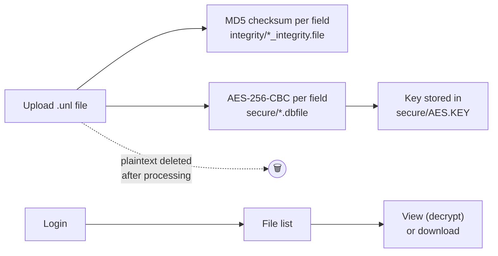

# Secure DB File

A PHP web tool that protects pipe-delimited `.unl` data files. It writes an MD5 integrity file, encrypts every field with AES-256-CBC, and lets a logged-in user view the decrypted records in a paginated table.

## How It Works



1. **Upload** a pipe-delimited `.unl` or `.txt` file (login required).
2. **Integrity file:** each field is hashed with MD5, and a summary line records the column and row counts.
3. **Encryption:** each field is encrypted with AES-256-CBC, using a random 256-bit key per file and a fresh random IV per field. A plain-text row number (RID) is added as the first column.
4. The uploaded plaintext file is **deleted** once processing finishes.
5. **View:** logged-in users pick an encrypted file and see it decrypted in a jQuery DataTables view, or download the encrypted file.

## Features

- Per-field AES-256-CBC encryption with OpenSSL, using a random key per file and a random IV per value
- Per-field MD5 integrity files with row and column counts
- Session-based login with a hashed password (`password_hash` / `password_verify`)
- CSRF protection on upload and logout
- Upload checks: `.unl` / `.txt` only, 20 MB limit, file names sanitised
- File names are validated before viewing or downloading, which blocks path traversal
- Data folders and dotfiles are blocked from direct web access

## Tech Stack

PHP 8.1+ · OpenSSL · jQuery · DataTables · HTML / CSS

## Getting Started

**Requirements:** PHP 8.1 or later with the `openssl` extension.

1. Create your `.env` from the template:

   ```bash
   cp .env.example .env
   php -r "echo password_hash('choose-a-password', PASSWORD_DEFAULT), PHP_EOL;"
   ```

   Put the username in `APP_USERNAME` and the generated hash in `APP_PASSWORD_HASH`.

2. Start the development server with the included router, which blocks the data folders and dotfiles:

   ```bash
   php -S localhost:8000 router.php
   ```

3. Open `http://localhost:8000/login.php`, log in, and upload `samples/customers-sample.unl` (synthetic data).

### Deploying on a web server

- **Apache 2.4:** the included `.htaccess` files deny access to `secure/`, `uploads/`, `integrity/` and all dotfiles. Make sure `AllowOverride` lets them take effect.
- **nginx** (ignores `.htaccess`), add:

  ```nginx
  location ~ /\.                              { deny all; }
  location ~ ^/(secure|uploads|integrity)/    { deny all; }
  ```

- Serve the app over HTTPS so the session cookie is marked `Secure`.

## Project Structure

```
├── index.php           # Upload page (login required)
├── login.php           # Login form and list of encrypted files
├── logout.php
├── view.php            # Decrypts and displays a .dbfile
├── download.php        # Downloads an encrypted .dbfile
├── auth.php            # .env loading, session, login and CSRF helpers
├── UnlReader.php       # Reads pipe-delimited .unl records
├── Md5Processor.php    # Writes MD5 integrity files
├── AesEncryption.php   # Encrypts files field by field
├── AesDecryption.php   # Decrypts .dbfile files
├── router.php          # Access rules for PHP's built-in server
├── samples/            # Synthetic sample data
├── secure/             # Encrypted files and AES.KEY (not committed)
├── integrity/          # Integrity files (not committed)
└── uploads/            # Temporary upload folder (not committed)
```

## Security Notes and Limitations

This is a learning project. Know these trade-offs before using it with real data:

- **Key storage:** the AES keys sit in `secure/AES.KEY` on the same server as the encrypted files, protected only by file permissions and web-server rules. A production system should keep keys in a key-management service or at least outside the web root.
- **No built-in tamper detection:** AES-CBC doesn't detect modified ciphertext, and MD5 checksums detect accidental corruption, not deliberate tampering. AES-GCM or an HMAC would add tamper detection.
- **Single user:** one account is configured in `.env`. There are no roles and no login rate limiting.
- **Never commit** `.env`, `secure/`, `uploads/` or `integrity/`. They are listed in `.gitignore`.
